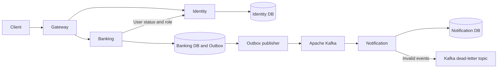

# Bank API

Bank API is a Java 21 banking backend built with Spring Boot, PostgreSQL and Apache Kafka. A single API Gateway serves registration, accounts, cards, transfers, transaction history, spending reports and administration. The microservices retain the V1 HTTP routes.

**Stack** · Java 21 · Spring Boot 4 · Spring Cloud Gateway · Spring Security · PostgreSQL 17 · Flyway · Apache Kafka 4.2 (KRaft) · Maven · Docker Compose · Testcontainers

## Architecture



| Maven module | Responsibility |
| --- | --- |
| [gateway-service](services/gateway-service) | Public HTTP entry point, request routing, JWT verification, authentication rate limiting and OpenAPI aggregation |
| [identity-service](services/identity-service) | Registration, login, profiles, roles and user blocking. Stores BCrypt password hashes and signs RS256 JWTs |
| [banking-service](services/banking-service) | RUB accounts, card issuance, deposits, withdrawals, transfers, history and reports. Owns balances and the Outbox |
| [notification-service](services/notification-service) | Consumes Kafka events, deduplicates by `eventId` and stores notification records in its own database |
| [web-support](services/web-support) | Shared library for JWT verification, API errors, OpenAPI and HTTP correlation |

Each stateful service owns its PostgreSQL database and Flyway migrations. Gateway verifies the JWT signature. Banking also checks the user's current role and status in Identity before handling a protected request. Administrative routes require `ADMIN`.

## Run locally

Install a JDK 21 and Docker with Docker Compose. Maven is needed for host-side builds and tests. Docker builds the application images using Maven.

```bash
git clone https://github.com/Hronos312/bank-api.git
cd bank-api
java tools/GenerateDevSecrets.java
docker compose --env-file secrets/compose.env up -d --build --wait
```

Run the generator once per local setup. It creates database passwords, an internal Identity API token and an RSA key pair under `secrets/`. Keep that directory private and reuse it when restarting the stack.

| Resource | Default address |
| --- | --- |
| Gateway | [http://localhost:8080](http://localhost:8080) |
| Swagger UI | [http://localhost:8080/swagger-ui/index.html](http://localhost:8080/swagger-ui/index.html) |
| Combined OpenAPI document | [http://localhost:8080/v3/api-docs](http://localhost:8080/v3/api-docs) |
| Gateway readiness | [http://localhost:8080/actuator/health/readiness](http://localhost:8080/actuator/health/readiness) |
| Kafka development listener | `127.0.0.1:9092` |

For an initial administrator, copy [`.env.example`](.env.example) to `.env`, set `ADMIN_EMAIL`, `ADMIN_PASSWORD` and `ADMIN_PHONE`, then run `docker compose --env-file .env --env-file secrets/compose.env up -d --build --wait`.

```bash
docker compose --env-file secrets/compose.env ps
docker compose --env-file secrets/compose.env down
```

The stop command preserves database and Kafka volumes. The default Compose configuration is intended for local development.

## Try the API

In Swagger UI, register a client with `POST /api/auth/register`, sign in with `POST /api/auth/login`, then paste `accessToken` into **Authorize**. Open an account with `POST /api/accounts` and use the returned ID to make a deposit. Use synthetic data on the local stack.

| Area | Routes |
| --- | --- |
| Identity | `POST /api/auth/register`, `POST /api/auth/login`, `GET /api/users/me` |
| Accounts | `POST /api/accounts`, `GET /api/accounts`, `GET /api/accounts/{id}` |
| Cards | `POST /api/accounts/{id}/card`, `GET /api/cards`, `GET /api/cards/{id}` |
| Money movements | `POST /api/accounts/{id}/deposit`, `POST /api/accounts/{id}/withdraw`, `POST /api/accounts/{id}/transfer` |
| History and spending | `GET /api/accounts/{id}/transactions`, `GET /api/reports/spending` |
| Administration | `/api/admin/users`, `/api/admin/accounts`, `/api/admin/cards`, `/api/admin/transactions` |

Example deposit. Replace `<account-id>` and `<access-token>` with the values from your session.

```http
POST /api/accounts/<account-id>/deposit
Authorization: Bearer <access-token>
Content-Type: application/json
Idempotency-Key: demo-deposit-001

{"amount":120.00}
```

Deposits, withdrawals and transfers accept an optional `Idempotency-Key`. For the same user, repeating the same request with the same key returns the original result. Reusing the key for a different operation returns `409 IDEMPOTENCY_CONFLICT`.

## Transaction and event guarantees

- **Balance consistency.** Banking locks account rows during balance updates and acquires both locks in ID order for transfers. Balance changes, the transaction record and the Outbox event commit together.
- **Outbox delivery.** The publisher claims pending events with a short database transaction, then sends them to `bank.transactions.v1`. Events can be delivered more than once, with the original `eventId`.
- **Notification deduplication.** Notification stores the processed event and its notification in one transaction. It acknowledges an invalid event after publishing it to `bank.transactions.v1.DLT`. Stored notifications are marked `PENDING` for a future delivery channel.
- **Diagnostics.** Actuator readiness checks, structured application logs in Russian and correlation IDs help follow requests and Kafka events across services.

## Build and verify

From the repository root, with Docker running:

```bash
mvn -B clean verify
```

The Maven reactor runs unit, MVC and Testcontainers integration tests with PostgreSQL and Kafka. [GitHub Actions](https://github.com/Hronos312/bank-api/actions/workflows/microservices.yml) also runs a Compose smoke test, a migration rehearsal and a dependency scan. See the [operations guide](docs/operations.md) for the recovery scenarios and how to run them locally.

## Documentation and versions

- [Service ownership, HTTP errors and Kafka events](docs/contracts.md)
- [Data migration and rollback](docs/migration.md)
- [Operations and troubleshooting](docs/operations.md)
- [V1 baseline](docs/v1-baseline.md) and [microservices roadmap](docs/roadmap.md)

The original monolith is available at [`v1.0.0`](https://github.com/Hronos312/bank-api/tree/v1.0.0). The verified microservices version is avaliable at [`v2.0.0-rc.1`](https://github.com/Hronos312/bank-api/tree/v2.0.0-rc.1).
