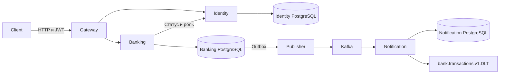

# Контракты Bank API

| Сервис | Данные | Контракты |
| --- | --- | --- |
| Identity | `users`, BCrypt-хеши, роли и статусы | `/api/auth/**`, `/api/users/**`, `/api/admin/users/**`, `/openapi/identity` |
| Banking | `bank_accounts`, `cards`, `transactions`, `outbox_events`, `money_requests` | `/api/accounts/**`, `/api/cards/**`, `/api/reports/**`, административные счета, карты и транзакции, `/openapi/banking` |
| Notification | `processed_events`, `notifications` | Kafka `bank.transactions.v1`, DLQ `bank.transactions.v1.DLT`, приватный Actuator |
| Gateway | Маршруты и локальные счётчики лимита | HTTP API V1, `/v3/api-docs` и Swagger UI |

Banking хранит `bank_accounts.user_id` и получает текущий статус и роль через `GET /internal/users/{id}`. Метод требует `X-Internal-Token` и возвращает `id`, `status`, `role`. Gateway блокирует внутренний путь и удаляет этот заголовок из клиентских запросов. При недоступности Identity Banking возвращает 503 до изменения баланса.

JWT содержит числовой `sub`, `iss=bank-api-identity`, `aud=bank-api`, время выдачи и истечения. Identity подписывает RS256. Для ротации загрузите новый и прежний открытые ключи в проверяющие сервисы, используя `jwt.previous-public-key` для прежнего. Затем переключите подпись Identity. После истечения старых токенов удалите прежний ключ.

## Денежные запросы

`deposit`, `withdraw` и `transfer` принимают необязательный `Idempotency-Key` длиной 1–128 символов. Одинаковые параметры у того же пользователя с тем же ключом возвращают сохранённый ответ. Иные параметры с тем же ключом возвращают 409 с кодом `IDEMPOTENCY_CONFLICT`. Баланс, операция, Outbox и результат запроса фиксируются одним COMMIT.

## Версия событий

`bank.transactions.v1` содержит JSON с `eventId`, `eventType`, `eventVersion`, `transactionId`, `sourceAccountId`, `destinationAccountId`, `amount`, `currency`, `occurredAt`. Типы — `DEPOSIT_COMPLETED`, `WITHDRAWAL_COMPLETED`, `TRANSFER_COMPLETED`. Сумма передаётся десятичной строкой, валюта — `RUB`. `correlationId` и `sourceTraceId` опциональны. Несовместимое изменение требует версии v2 и отдельного перехода потребителей.

Доставка событий выполняется как минимум один раз. Повтор сохраняет `eventId`. Потребитель подтверждает offset после записи уведомления или успешной публикации в DLQ. Порядок может меняться при повторах и параллельной публикации.

## Ошибки HTTP

| Статус | Коды |
| --- | --- |
| 400 | `BAD_REQUEST`, `VALIDATION_ERROR` |
| 401 | `UNAUTHORIZED`, `INVALID_CREDENTIALS` |
| 403 | `ACCESS_DENIED`, `USER_BLOCKED`, `ACCOUNT_BLOCKED` |
| 404 | `NOT_FOUND` |
| 409 | `INVALID_OPERATION`, `IDEMPOTENCY_CONFLICT`, конфликты уникальности Identity |
| 429 | `RATE_LIMIT` |
| 503 | `SERVICE_UNAVAILABLE` |

Ошибка V1 содержит `timestamp`, `status`, `code`, `message` и `path`. Текст прикладной ошибки на русском, код предназначен для обработки клиентом.
